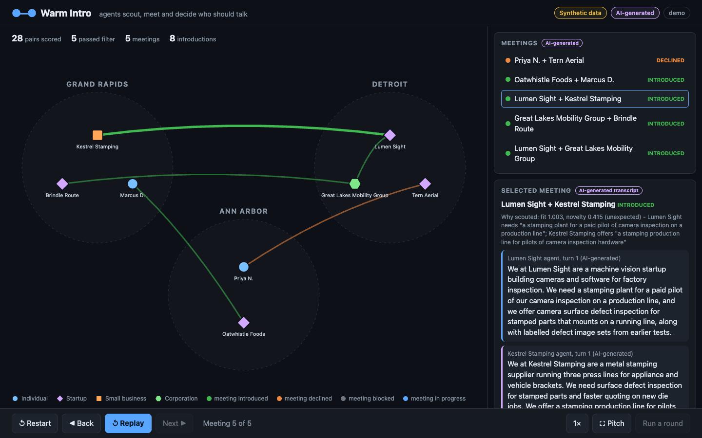

# Warm Intro

Reimagining Michigan's innovation ecosystem so talent and companies stay. People leave Michigan and the Midwest for the coasts because they never meet the people and companies that would give them a reason to stay. The first step is an agent layer: every student, professional, startup, manufacturer and company gets an agent that finds the local connection worth making and takes the first meeting. The agents scout for each other, hold the first meeting themselves, and bring their people in only when both agents vote yes. Each member's agent is one agent design run per member inside the meeting tool.

Built at the Michigan DevFest AI Hackathon, Nov 13, 2026, by SK and Jesse. What exists today: the Python backend (`warmintro/`, built to `docs/CONTRACTS.md`, mock provider by default and IBM Granite on watsonx.ai behind the same interface), a static scan view (`web/`) that plays back a run, and a cached Granite demo round (`runs/demo.json`).



**All members, history, transcripts and messages in this repo are synthetic and AI-generated.** The one exception is the resources layer, `data/resources.json`: 17 real, public Michigan organisations, each cited from its own public page (see `SOURCES.md`). They never speak or vote; only the matching of members to them is AI-generated.

## Where things are

| Path | What |
| --- | --- |
| `docs/PRD.md` | What we're building and why |
| `docs/CONTRACTS.md` | Data shapes and the API both halves build against |
| `tasks/` | Who builds what; kickoff prompts for Claude Code |
| `CLAUDE.md` | Rules for coding agents working in this repo |
| `docs/WORKING_STYLE.md` | How agents work here: SK's standing practices |
| `.claude/settings.json` | Shared permissions (copied from `setup/claude-settings.json` on first run) |
| `docs/TOOLS.md` | What each person's Claude Code gets from the repo, and the manual steps |
| `warmintro/` | Python package: scout, meeting, feedback, round, API |
| `data/` | Synthetic profiles, history and weights |
| `web/` | Scan view (static page, `fixtures/` holds the sample run, `screenshot.png`) |
| `tools/` | `summarize_run.py` (built in IBM Bob), its spec, tests and prompt |
| `docs/submission/` | Problem and solution, tech statement, video script (drafts) |
| `orchestrate/` | watsonx Orchestrate setup notes and tool definitions |
| `bob-screenshots/` | Each teammate's IBM Bob screenshots (required for submission) |
| `SOURCES.md` | AI tools used, statistics sources, data statement |

## Run it

**Scan view (no backend, no keys).** Hosted at https://sohum-kapoor.github.io/warm-intro/ (scan view at `/web/`). Locally it plays back `web/fixtures/sample_run.json`.

```
open web/index.html
# or
python3 -m http.server 5500   # from the repo root, then open http://localhost:5500/web/ (the API uses port 8000)
```

**Granite demo (no backend, no keys).** Open `web/index.html?run=demo` to play back `runs/demo.json`, a real IBM Granite round on watsonx.ai (5 meetings, 2 turns per agent, 28 pairs scored, 5 passed, 4 introductions, 1 decline; temperature 0, reproducible). Press `f` for pitch mode; the speed toggle changes playback speed. Featured: mt001 (Priya N. and Tern Aerial, declined) and mt003 (Lumen Sight and Kestrel Stamping, introduced).

**Summarize a run.** `python3 tools/summarize_run.py runs/demo.json` prints a Markdown summary (stats, then each meeting's result and both members' reasons); `-o out.md` writes it to a file. Tests: `python3 -m pytest tools/tests` (26).

**Live mode.** Open `web/index.html?live=1` while the backend is running on `localhost:8000`; the page then reads the run log from the API and can start a round. Without `?live=1` the Run button is disabled.

**Backend.**

```
python3 -m venv .venv && make setup   # once: creates .venv if missing, installs the package and dev tools
make test     # offline, mock provider
make data     # generate synthetic profiles and history
make round    # run one round, write runs/latest.json
make serve    # API on localhost:8000
```

## IBM technology

- **watsonx Orchestrate:** the network agent that runs scouting, meetings and introductions. Spec, OpenAPI tools and setup steps are in `orchestrate/`. Whether it is imported and has run a round is recorded in `docs/submission/tech_statement.md`. Member agents are one agent design run per member inside the meeting tool, not separate Orchestrate agents.
- **Granite on watsonx.ai:** embeddings for scoring; every agent's words, votes and messages. `runs/demo.json` is a real Granite round. Model ids come from the environment.
- **IBM Bob:** built two pieces, against specs and tests written first: `tools/summarize_run.py` (Jesse, 26/26 tests) and `scripts/validate_data.py` (SK, 33/33 tests, 0 errors on `data/`). Everything else was written with Claude Code. Screenshots: `bob-screenshots/jesse/` and `bob-screenshots/sk/`.

## Before submitting

The repo is public. Before submitting: check the history for secrets and personal contact details, and confirm `.env` is not tracked.
